# ELEC 4 – Python Programming Activities

## Prepared By:

**Kate Diane Inoue**
- IV-BSIT B
- LNO1_ELEC4 – Elective 4 (Special Topics on Web and Mobile 2)

## Activities

| Activity | Description | Folder |
|---|---|---|
| Set 1 - P1: Student Grade Calculator | A Python program that accepts and validates grades for six subjects, calculates the average, identifies the highest and lowest grades, and determines the student's pass/fail status. | [P1 - Student Grade Calculator](set1/p1/) |
| Set 1 - P2: Custom Module | A Python program that uses a custom module to calculate the average, highest and lowest grades, and determine the student's pass/fail status. It also displays the report date and time. | [P2 - Custom Module](set1/p2/) |
| Set 1 - P3: Student Record Manager | A Python program that adds, removes, searches, and displays student names. It uses a List to store student names and a Set to prevent duplicate entries. | [P3 - Student Record Manager](set1/p3/) |
| Set 1 - P4: Safe Menu Program | A menu-driven Python program that performs division, reads file contents, and handles invalid numbers, division by zero, missing files, and invalid menu selections. | [P4 - Safe Menu Program](set1/p4/) |

## How to Run

Before running any activity:

1. Open the repository folder in Visual Studio Code.
2. Open the terminal using CMD.
3. Make sure the terminal is in the repository's root directory.

### Set 1 - P1: Student Grade Calculator

Execute the following command:

```cmd
python set1/p1/p1_grade_calculator.py
```

Follow the menu instructions to enter grades and view the results.

### Set 1 - P2: Custom Module

Execute the following command:

```cmd
python set1/p2/p2_main.py
```

Enter the grades for each subject. Make sure `p2_main.py` and `student_utils.py` remain in the same folder.

### Set 1 - P3: Student Record Manager

Execute the following command:

```cmd
python set1/p3/p3_record_manager.py
```

Use the menu to add, remove, search, and display student names.

### Set 1 - P4: Safe Menu Program

Execute the following command:

```cmd
python set1/p4/p4_exceptions.py
```

Use the menu to test the division operation, file reading, and exception handling.

## Screenshots

### Set 1 - P1: Student Grade Calculator

The screenshot below shows the program execution and its output.


### Set 1 - P2: Custom Module

**Passing Result**

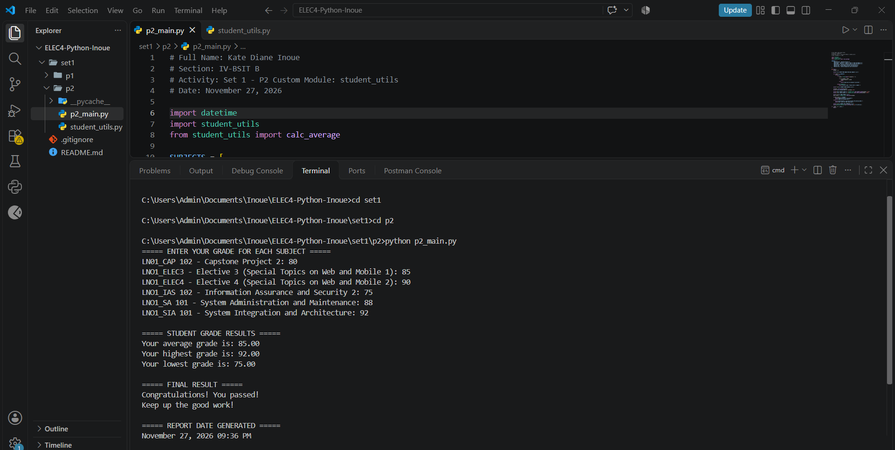

**Failing Result**

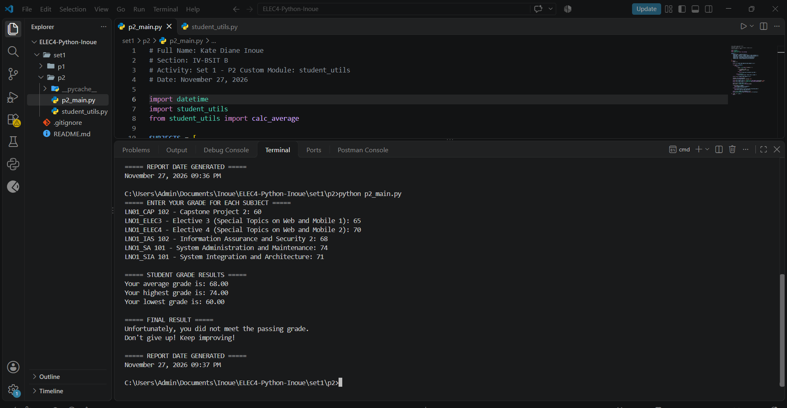

### Set 1 - P3: Student Record Manager

**Adding Students**

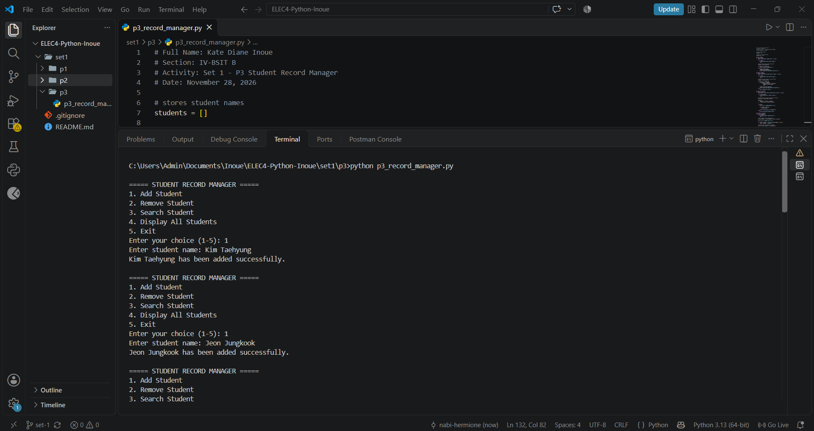

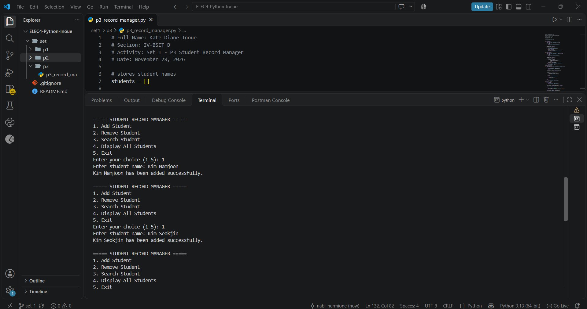

**Duplicate Prevention**

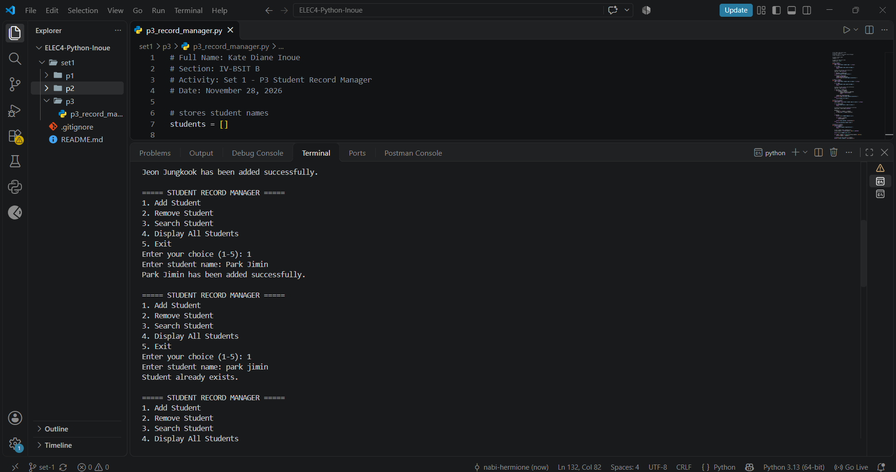

**Searching and Removing Students**

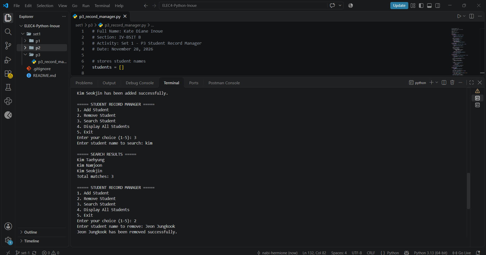

**Displaying All Students**

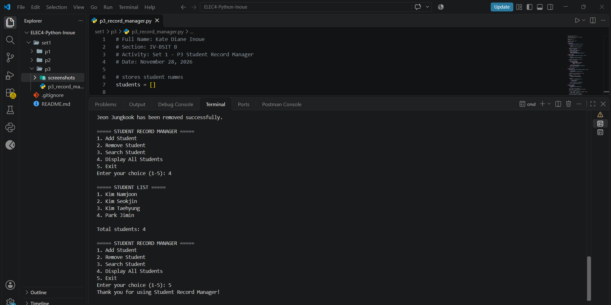

### Set 1 - P4: Safe Menu Program

**Invalid Number**

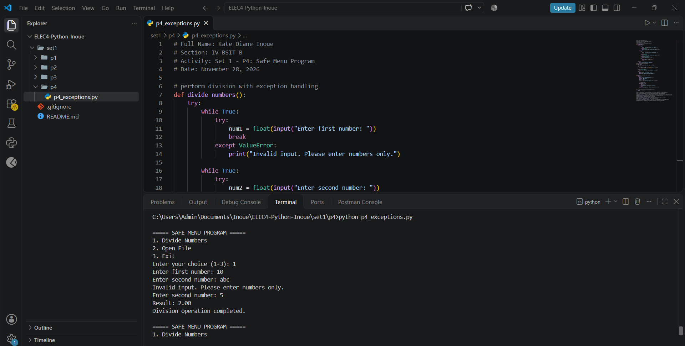

**Division by Zero**

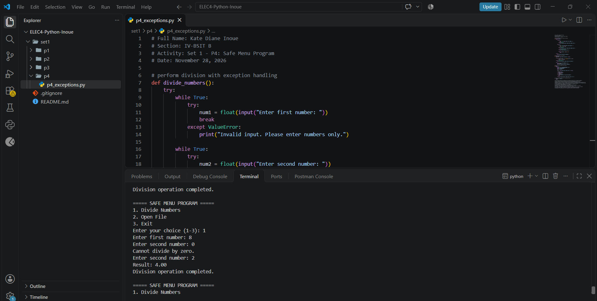

**Missing File**

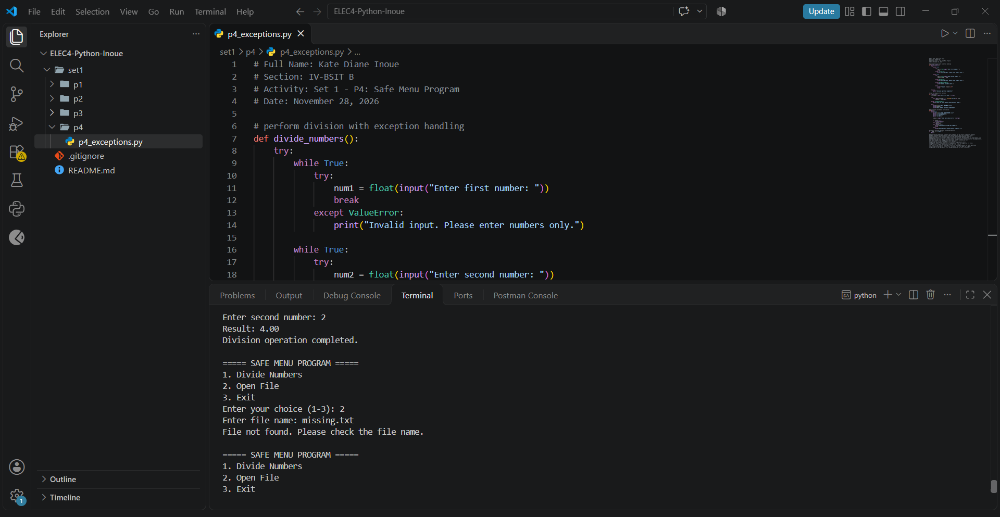

**Invalid Menu Choice**

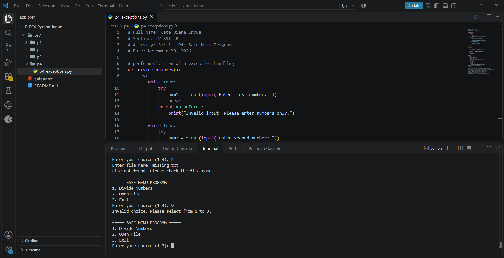